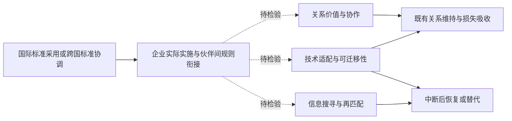

# 标准国际化与供应链韧性：文献综述与研究定位

更新日期：2026年10月20日。范围：国际标准采用与协调、企业跨国供应关系、冲击传播、关系维持及中断后的恢复与替代。

本文是一份基于公开可核验来源的主题性文献综述。正文整合研究脉络，文献矩阵记录方法、适用边界和实际核验深度，末尾列出完整书目与检索说明。理论预期、经验发现和本文提出的研究推论分别表述。

## 一、核心判断与概念边界

标准国际化与供应链韧性的联系，可以沿着“共同技术规则—交易与适配摩擦—关系维持及重新匹配”展开。现有研究已分别讨论标准协调的贸易效果、专用性投入的冲击传播、客户搜寻和关系资本，也已有研究直接把兼容性标准纳入供应链韧性模型。因而，值得推进的问题是：**哪一类标准、通过何种摩擦、在什么冲击和网络结构下，改变既有关系的存续以及中断后的恢复与替代？**

首先需要区分标准研究中的不同处理变量。

| 概念 | 本综述中的含义 | 不能直接等同的变量 |
| --- | --- | --- |
| 国际标准采用 | 国内标准或企业实践对国际标准的引入与实施 | 企业参与标准制定、取得任意认证 |
| 标准制定参与或标准走出去 | 参与规则形成，或本国标准被境外接受、使用 | 采用已有国际标准 |
| 标准协调 | 不同经济体采用或认可相同、等效的标准规范，具体口径依文献定义 | 已经实现所有产品的技术互换 |
| 合格评定互认 | 对检测、认证等评定结果的跨境接受安排 | 技术要求本身已经统一 |
| 技术兼容性 | 产品、接口或流程能够实际衔接、替换和组合 | 标准数量增加或文本采用比例提高 |
| 国内流通或物流标准化 | 国内流通规则、设施与作业要求的标准化 | 国际标准采用或跨国协调 |

WTO《技术性贸易壁垒协定》分别规定技术法规、标准和合格评定程序，并对相关国际标准的使用作出安排。这一制度区分意味着，标准文本趋同与认证结果互认应分别衡量，不能假定采用同一标准就自动消除重复检测。[WTO协定原文](https://www.wto.org/English/tratop_e/tbt_e/tbtagr_e.htm)

供应链韧性同样具有过程性。Christopher和Peck（2004）、Ponomarov和Holcomb（2009）以及Pettit等（2010）将其置于扰动、脆弱性与应对能力的关系中。结合企业间交易数据，可区分三个观察环节：冲击下的关系维持和损失吸收；中断后与原伙伴恢复交易；中断后与新伙伴形成可用替代关系。本文采用这一划分组织文献，**它是本综述的分析框架，并非所有文献使用的统一指标体系**。

出口增长、供应商数量增加、关系持续更久都可能与韧性有关，但各自不能覆盖上述完整过程。尤其是低流动性的关系，既可能有较高信任与协调效率，也可能存在难以退出的技术锁定。

## 二、标准国际化研究：从兼容性收益到跨国市场参与

### 2.1 兼容性与协调：共同规则为什么有经济价值

标准的经济作用不仅在于提高技术要求，还在于让不同主体形成可共同使用的规则。Farrell和Saloner（1985）揭示了兼容性收益与技术转换中的协调问题：标准化能够促进衔接，但既有标准也可能带来转换惯性。因此，“标准越多”或“标准越统一”本身不能推出效率持续提高。[Farrell和Saloner，1985](https://doi.org/10.2307/2555589)

这一理论起点对供应链研究的启示在于，标准可能同时改变继续使用原技术体系的收益和转向其他技术体系的成本。若研究只记录行业采用了多少国际标准，就仍需要进一步说明：这些标准约束的是产品质量、接口兼容、信息交换，还是检测认证；它们是否真正改变了企业之间的可替代性。Swann（2010）的研究综述也说明，标准与贸易的关系需要结合标准类型及其作用方式理解。[Swann，2010](https://doi.org/10.1787/5kmdbg9xktwg-en)

Moenius（2004）将标准的信息作用与产品适应成本并置，提示某些标准虽增加合规要求，也可能提供市场需求信息。它为区分信息搜寻与技术改造两类摩擦提供了早期依据；该文为工作论文，不与正式期刊文献混列状态。[Moenius，2004](https://doi.org/10.2139/ssrn.608022)

### 2.2 标准协调与互认：贸易便利是否具有包容性

跨国标准安排并不天然产生相同效果。Chen和Mattoo（2008）将协调与互认放在同一贸易分析框架中，强调参与方与第三方所面对的影响可能不同；Czubala等（2009）在非洲纺织服装对欧盟出口情境中区分与国际标准协调的欧洲标准和其他欧洲标准。这些研究共同提示，研究者必须关注共同规则的覆盖范围以及未被纳入规则体系的企业。[Chen和Mattoo，2008](https://doi.org/10.1111/j.1540-5982.2008.00488.x)；[Czubala等，2009](https://doi.org/10.1093/jae/ejp003)

Blind等（2018）已直接研究欧洲单一市场中的标准与全球价值链贸易，区分国家、欧洲和国际标准，并比较增加值贸易与总额贸易。这意味着，标准与跨国生产网络的连接本身已有经验基础；但该文的结果仍是贸易和价值链参与，不能替代危机恢复的证据。[Blind等，2018](https://doi.org/10.1080/09692290.2017.1402804)

Schmidt和Steingress（2022）进一步利用标准协调变化研究贸易效应，并考察法国企业的差异化反应。本文依据2022年期刊版本概括其结果：协调改善贸易，但企业反应存在规模异质性，不能据此写成所有企业都更容易进入出口市场。它支持“跨国适配摩擦会影响交易”的判断，尚不直接回答既有关系能否承受冲击。[Schmidt和Steingress，2022](https://doi.org/10.1016/j.jinteco.2022.103619)

### 2.3 中国证据：市场拓展、质量升级与供应链传导

中国研究已从一般贸易增长推进到企业行为和供应链传导。韩剑等（2024）考察标准国际化与出口产品质量；王艳艳等（2025）以国际标准采用效率研究企业国际市场拓展。这些研究为质量信号、技术调整和市场参与提供依据，但质量提高、出口范围扩大与冲击后的恢复能力仍是不同结果。[韩剑等，2024](https://doi.org/10.19744/j.cnki.11-1235/f.2024.0132)；[王艳艳等，2025](https://doi.org/10.19744/j.cnki.11-1235/f.2025.0134)

姜彩楼等（2026）更直接把标准国际化放进客户—供应商关系，发现客户企业标准国际化与上游供应商出口增长相联系，并讨论信息传递和标准适配渠道。这表明，仅把研究对象从企业移动到“供应链”层面，已经不足以构成独立增量；应进一步研究冲击、关系中断和重配过程。该文的出口增长结果也不能被改写为供应链韧性已获检验。[姜彩楼等，2026](https://doi.org/10.13510/j.cnki.jit.2026.05.002)

在测度方面，Bjørkholt（2026）的StanDat数据论文将ISO公开信息结构化，为研究国际标准及其网络提供了数据路线。它不是企业真实采用数据库，也不能替代中国行业采用效率或企业实际执行信息。本文所涉及的标准变量横跨国家、行业、企业和关系层面，比较结论前应先比较变量含义。[Bjørkholt，2026](https://doi.org/10.1017/psrm.2025.3)

## 三、供应链韧性研究：投入约束、关系资本与网络传播

### 3.1 技术专用性决定冲击后的替代难度

生产网络研究将韧性问题推进到可识别的技术约束。Barrot和Sauvagnat（2016）利用自然灾害研究企业特异性冲击，显示投入专用性会加剧冲击沿供应关系传播。Boehm等（2019）利用日本东北地震考察投入联系，说明关键投入的短期替代受到强互补性约束。Carvalho等（2021）则在日本企业生产网络中识别上下游及间接传播。[Barrot和Sauvagnat，2016](https://doi.org/10.1093/qje/qjw018)；[Boehm等，2019](https://doi.org/10.1162/rest_a_00750)；[Carvalho等，2021](https://doi.org/10.1093/qje/qjaa044)

这些研究为“兼容性可能重要”提供了技术背景，但投入专用性、生产互补性与标准不兼容并不相同。缺少可替代产能、模具调整困难、运输中断和认证不互认，都可能造成替代失败。标准国际化研究需要识别其中究竟哪一种约束发生了改变，不能把一切替代困难都归结为标准差异。

### 3.2 关系资本能够缓冲冲击，但关系持续并非单调的韧性信号

关系契约研究补充了纯技术解释。Macchiavello和Morjaria（2015）在肯尼亚玫瑰出口中考察关系价值、声誉与供给冲击，表明关系年龄与冲击期间交付并不是简单单调关系。Scholten和Schilder（2015）的买卖方案例研究则将信息共享、共同知识创造和协作沟通与韧性能力联系起来。前者强调履约激励，后者提供协作过程证据，两者的研究设计和可外推范围应分别保留。[Macchiavello和Morjaria，2015](https://doi.org/10.1257/aer.20120141)；[Scholten和Schilder，2015](https://doi.org/10.1108/SCM-11-2014-0386)

同时，Gereffi等（2005）的价值链治理框架将交易复杂性、信息可编码性和供应商能力联系起来。它提示，共同规则既可能便利伙伴协作，也可能让交易更加模块化，降低持续进行双边协调的必要性。因此，标准国际化是否深化关系投入，应作为有条件命题，而不宜预设为必然结果。[Gereffi等，2005](https://doi.org/10.1080/09692290500049805)

Martin等（2026）关于关系黏性与不确定性的研究进一步表明，新关系建立和旧关系中断会随市场黏性呈现不同调整方式。这使“保持原关系”和“具备调整能力”之间的区别更加重要。该文正式刊期为2026年，早期版本出现于2023年，本综述按正式版本列示。[Martin等，2026](https://doi.org/10.1162/rest_a_01396)

## 四、中断后的恢复与替代：搜寻、学习和兼容伙伴集合

关系中断后的重构需要企业找到合适伙伴，并完成识别、沟通与适配。Rauch（1999）的网络与搜寻视角提供了这一研究谱系的基础。Eaton等（2025）进一步用哥伦比亚制造业对美买卖方交易估计包含客户搜寻、可见性和市场学习的动态模型，说明新客户积累需要时间，既有客户基础和市场知识具有价值。[Rauch，1999，发表版书目及早期摘要](https://www.nber.org/papers/w5617)；[Eaton等，2025](https://doi.org/10.1016/j.jinteco.2025.104155)

中国出口动态研究同样强调市场试探。铁瑛等（2023）从生产率排序、多产品出口试探和不完全信息出发分析出口稳定性。这些文献共同说明，企业增加新客户可能属于正常市场扩张，也可能源于原关系中断后的替代需求。只有把新关系放回具体的冲击与中断时间线，才能讨论其作为重构能力的含义。[铁瑛等，2023](https://www.suibe.edu.cn/2023/0322/c6378a156981/page.htm)

由此可提出一条连接标准与重构的研究推论：共同技术规则可能提高需求信息的可比性，降低技术沟通和验证成本，并扩大能够实际合作的伙伴范围。不过，“更容易遇到伙伴”“遇到后更容易通过技术验证”以及“验证后能够满足订单”是不同环节。仅观察新增客户增加，不能区分这些机制，更不能证明原订单规模或交易绩效已经恢复。

## 五、直接交叉与邻近证据：已经知道什么

### 5.1 兼容性标准与专用化：已经存在直接理论连接

Ferrari和Pesaresi（2026）直接研究产品专用化、兼容范围和供应链韧性。其模型中，专用化提高附加值，却缩小兼容交易对象集合；这种选择影响中断后替换供应商的速度，并可能因网络外部性偏离社会最优。论文还讨论兼容性标准的作用。因此，将标准、兼容性与韧性联系起来，已有明确理论先例。这里的证据是模型结论，不能改写为中国企业国际标准采用的因果事实。[Ferrari和Pesaresi，2026，CEPR DP21139](https://cepr.org/publications/dp21139)

这一研究还存在观察方向上的边界：最终生产者替换上游投入，与中国供应商在海外客户退出后寻找新客户，是不同的交易方向。要把机制转入后者，需要明确标准如何改变客户适配和可销售市场，不能只替换模型中的主体名称。

### 5.2 国内标准化政策提供邻近经验依据

李施宇和唐松（2026）利用商贸流通标准化试点研究服务对象企业的供应链韧性，讨论地理分布多元化、供需匹配及上下游协同。Liu等（2026）研究流通节点城市与物流标准化试点的政策叠加，考察设施与制度协同。两项研究为标准化和韧性的经验联系提供了邻近证据，但识别对象是国内流通或物流标准化，不能替代对跨国技术标准协调的检验。[李施宇和唐松，2026](https://doi.org/10.16538/j.cnki.jfe.20250923.101)；[Liu等，2026](https://doi.org/10.1080/00036846.2026.2688898)

### 5.3 数据互操作与风险治理提供技术解释

Villar等（2024）提出开放知识与数据标准框架，讨论制造网络中的互操作、供应商或产品替代及资源再利用。NIST（2026）的制造业供应链溯源技术报告进一步讨论异构系统之间的可互操作接口和标准化事件数据。它们解释了共同信息结构可能如何支持调整，但前者主要是概念设计，后者属于技术报告，均不能当作国际标准政策的计量验证。[Villar等，2024](https://doi.org/10.1007/s43069-024-00303-1)；[NIST IR 8536，2026](https://doi.org/10.6028/NIST.IR.8536)

### 5.4 更强韧性与更高社会福利需要分别论证

Grossman、Helpman和Lhuillier（2023）说明，多元化和回流政策的最优选择依赖需求结构与风险设定；Grossman、Helpman和Sabal（2024）进一步将防护投资、网络形成和外部性纳入多层供应链模型。这些研究支持将企业选择与社会最优分开。因此，即使发现关系断裂减少或替代加快，也仍需成本、价格及网络外部性证据，才能进一步讨论福利改善。[Grossman等，2023](https://doi.org/10.1086/725173)；[Grossman等，2024](https://doi.org/10.1093/qje/qjae024)

## 六、综合机制、文献张力与研究缺口

### 6.1 三条可检验路径

以下是对上述文献的综合推论，不表示各项路径均已被现有标准国际化实证独立识别。

| 路径 | 中间环节 | 对应结果 | 需要补充的证据 |
| --- | --- | --- | --- |
| 关系价值与协作 | 技术表达更清晰、沟通与联合调整更便利 | 冲击期间交付和关系存续 | 实际协作变化；不能只以关系年龄代替关系资本 |
| 技术适配与可迁移性 | 接口、参数或验证程序衔接，合格替代对象范围扩大 | 中断概率、适配耗时、替代速度 | 哪类标准改变兼容性；排除产能、运输等其他瓶颈 |
| 信息搜寻与再匹配 | 需求可比性、识别及验证成本变化 | 原客户恢复、新客户替代、恢复时长 | 区分遇见、验证和成交；识别断后调整与正常扩张 |

该图只表示文献整合后的分析路径，不是已经识别的因果图；共同冲击、企业选择和反向因果仍须处理。

### 6.2 看似相反的结论如何放在一起

| 文献之间的张力 | 比较对象 | 本综述的解释与未决问题 |
| --- | --- | --- |
| 标准促进贸易，但收益可能不均等 | Chen和Mattoo（2008）与Schmidt和Steingress（2022） | 安排覆盖范围与企业规模不同；总体交易增加并不意味着第三方和所有企业均获益 |
| 关系资本支持履约，而投入专用性增加替代困难 | Macchiavello和Morjaria（2015）与Barrot和Sauvagnat（2016） | 前者侧重声誉与履约激励，后者侧重投入替代；两种机制可以同时存在，但不能把关系资本与技术专用性视为同一变量 |
| 协作增强应对能力，但可编码性也可能减少双边协调 | Scholten和Schilder（2015）与Gereffi等（2005） | 模块化与关系互补是不同组织路径，尚不能推断标准必然提高关系投入 |
| 扩大兼容范围可能加快替代，但更多多元化并非总有更高福利 | Ferrari和Pesaresi（2026）与Grossman等（2023） | 模型决策、外部性和需求结构不同；技术可替代性、实际多元化与福利应分别识别 |
| 标准国际化的供应链传导与标准化的韧性效果并非同一证据 | 姜彩楼等（2026）与李施宇和唐松（2026） | 前者处理国际化标准与出口传导，后者处理国内标准化与韧性；不能拼接成一条已证实的因果链 |

这些比较是限定范围内的解释性判断，仍需研究者结合全文与具体研究设计确认，并非对全部文献两两矛盾的穷尽检验。

### 6.3 可以推进的研究问题

**第一，从市场拓展推进到冲击下的关系调整。** 在已识别的标准变化下，同时考察既有关系中断、原客户恢复和跨客户替代。新的结果变量只有与冲击、观察窗口及风险集定义相结合，才构成清楚的研究问题。

**第二，从行业采用推进到双边技术衔接。** 行业国际标准采用效率刻画共同环境，企业海外收入权重反映事前暴露，两者的乘积不直接观察企业执行情况。更贴近机制的证据包括标准所对应产品、接口或评定程序，以及交易双方规则的实际重合程度。行业采用与双边兼容性应分层讨论。

**第三，同时识别关系维持收益与退出、替代机会。** 标准改善新客户机会后，企业可能主动调整旧关系；关系流动上升未必代表抵抗力下降。可结合交易规模、交付、存续收益和重新匹配速度，判断观察到的是被动断裂、主动换客还是正常扩张。这是由文献提出的待检验解释。

**第四，处理断后样本选择。** 若标准本身改变中断概率，只在已中断关系中比较恢复结果，可能混入样本组成变化。可先区分全体事前关系的中断风险与中断条件下的重构，再根据数据考虑多状态转移或相应选择处理。原客户恢复和新客户替代也可能先后发生，不应未经核查就假设互斥。

**第五，让识别策略对应标准变化的层级。** 固定基期暴露权重能够避免当期海外收入机械进入解释变量，却不能自动消除标准采用的内生性。研究应检查标准更新与行业需求、产品升级、其他贸易政策的共同变化；如采用政策DID，应核对分期实施、预期反应、平行趋势及政策叠加。不同层级处理变量产生不同估计含义，不存在仅凭固定效应更丰富就足以认定因果的方法。

**第六，保留网络层面的权衡。** 共同技术规则可能扩大可替代伙伴集合，但同质技术依赖、认证成本或集中采购也可能改变共同风险暴露。这些反向作用在本次语料中未被统一识别，应作为边界条件检验，不能写成已确定的负向结果。

### 6.4 适用于相关论文的文献定位

一个较稳妥的定位是：标准国际化研究已揭示贸易、质量及供应链出口传导等效果；生产网络和关系契约研究揭示技术约束与关系价值在冲击中的作用；兼容性标准与韧性的理论联系也已建立。在此基础上，进一步研究中国供应商面向海外客户时，标准变化如何分别影响既有关系中断、原客户恢复和跨客户替代，并明确实际技术衔接及信息摩擦的证据。该定位的价值取决于结果定义、识别和机制证据，不能单靠“首次结合两个主题”或“首次使用供应链数据”确立。

## 七、文献证据矩阵

收录31项研究与技术资料，按研究用途分类，而非按结论方向筛选。核验标记：**F**＝读取原文相关节段；**A**＝作者、期刊或机构的摘要；**M**＝元数据。F不表示逐页精读、证明复核或回归复现；“作者稿”与“期刊版”在表内保留区别。

### 7.1 标准、贸易与国际市场参与

| 编号与文献 | 方法或对象 | 可用于综述的内容 | 边界与核验深度 |
| --- | --- | --- | --- |
| [S01](#s01) Farrell和Saloner（1985） | 兼容性与技术转换理论 | 兼容收益与协调惯性并存 | 非韧性经验研究；A＋M |
| [S02](#s02) Moenius（2004） | 标准与贸易引力回归；工作论文 | 标准具有信息与产品适应双重作用 | 不提供断链或恢复识别；作者稿摘要索引A＋M |
| [S03](#s03) Chen和Mattoo（2008） | 制造业贸易面板；协调与互认安排 | 成员与局外人的影响不同 | 不能把区域安排等同全球兼容；期刊F＋A |
| [S04](#s04) Czubala等（2009） | 非洲纺织服装出口、样本选择引力模型 | 与国际标准协调的欧洲标准限制性较弱 | 工作稿细节不冒充最终估计；期刊A、早期稿F |
| [S05](#s05) Swann（2010） | OECD经验文献综述报告 | 标准类型、计数和实际使用需要区分 | 是历史综述，不是2026年穷尽检索；报告F |
| [S06](#s06) Blind等（2018） | 欧洲价值链与增加值贸易、面板引力模型 | 国家、欧洲和国际标准作用不同 | 研究贸易参与，未识别危机恢复；原刊A、正文索引片段 |
| [S07](#s07) Schmidt和Steingress（2022） | 标准协调DID与法国企业资料 | 贸易改善具有规模异质性 | 进入效应不可沿用2019旧稿；2022作者稿F、期刊A |
| [S08](#s08) Bjørkholt（2026） | ISO公开信息结构化、StanDat数据论文 | 国际标准及网络的数据路线 | 不是企业实际采用或韧性数据库；原刊F |
| [S09](#s09) 韩剑等（2024） | 中国工业、海关与国家标准匹配研究 | 国际采标、标准走出去与出口质量 | 理论提到韧性不等于实证检验；原文副本节段F、作者书目M |
| [S10](#s10) 王艳艳等（2025） | 中国上市公司与行业采标效率；IV等策略 | 国际标准采用与市场拓展 | 出口范围与客户稳定性不同；原文F、作者单位A |
| [S11](#s11) 姜彩楼等（2026） | 客户—供应商关系经验研究 | 客户标准国际化向供应商出口传导 | 未据摘要扩写样本年份或识别细节；原刊A＋M |

### 7.2 韧性、关系价值与生产网络

| 编号与文献 | 方法或对象 | 可用于综述的内容 | 边界与核验深度 |
| --- | --- | --- | --- |
| [S12](#s12) Christopher和Peck（2004） | 供应链韧性的概念性研究 | 脆弱性与应对、恢复能力 | 无标准政策因果识别；原刊A＋M |
| [S13](#s13) Ponomarov和Holcomb（2009） | 跨学科整合性回顾 | 准备、响应与恢复的过程视角 | 稳定或增长不覆盖完整韧性；原刊A＋M |
| [S14](#s14) Pettit等（2010） | 概念框架与焦点小组 | 脆弱性与能力需要匹配 | 不能替代外生冲击的因果估计；原刊A＋M |
| [S15](#s15) Scholten和Schilder（2015） | 食品加工八组买卖方关系案例 | 信息共享和协作形成韧性能力 | 案例机制不等于标准效果；正式PDF节段F |
| [S16](#s16) Macchiavello和Morjaria（2015） | 肯尼亚玫瑰出口供给冲击、关系契约 | 关系价值影响冲击期间履约 | 关系年龄与履约并非单调；AEA摘要与解读A |
| [S17](#s17) Barrot和Sauvagnat（2016） | 自然灾害与供应商—客户网络 | 专用投入放大冲击传播 | 专用性不等于标准不兼容；期刊与MIT作者记录A＋M |
| [S18](#s18) Boehm等（2019） | 日本地震及美国企业进口投入、自然实验 | 强互补性限制短期替代 | 方法细节来自早期作者稿，不报告未核最终系数；作者稿F、正式M |
| [S19](#s19) Carvalho等（2021） | 日本企业网络、地震DID与网络模型 | 冲击沿直接和间接关系传播 | 不直接检验标准或断后重配；正式PDF节段F |
| [S20](#s20) Martin等（2026） | 法国贸易关系、不确定性与关系黏性 | 新建和中断呈现不同调整方式 | 非已断关系恢复研究；2023作者稿F、2026正式A＋M |
| [S21](#s21) Gereffi等（2005） | 全球价值链治理理论与行业例证 | 可编码性、复杂性与供应商能力影响治理 | 不是标准必然深化关系的证据；原刊A＋M |
| [S22](#s22) Rauch（1999） | 国际贸易的网络与搜寻视角 | 差异化交易的信息摩擦研究谱系 | 本轮使用早期官方摘要和发表版书目；早期稿A、正式M |
| [S23](#s23) Eaton等（2025） | 哥伦比亚对美交易、客户搜寻与学习结构模型 | 客户积累与市场知识影响关系动态 | 没有国际标准冲击；正式PDF节段F |
| [S24](#s24) 铁瑛等（2023） | 中国海关、多产品试探与不完全信息模型 | 出口扩张与稳定性不能简单等同 | 不检验标准；作者单位A＋M |

### 7.3 直接交叉、邻近政策与网络福利

| 编号与文献 | 方法或对象 | 可用于综述的内容 | 边界与核验深度 |
| --- | --- | --- | --- |
| [S25](#s25) Ferrari和Pesaresi（2026） | 专用化、兼容性与生产网络理论；CEPR工作论文 | 直接连接兼容性标准与中断后替代 | 理论证据；不代表中国采标因果效果；CEPR与arXiv A＋M |
| [S26](#s26) 李施宇和唐松（2026） | 国内流通标准化试点DID | 标准化与企业韧性的直接邻近经验 | 韧性为综合指标，非跨国关系逐对断裂；原刊F |
| [S27](#s27) Liu等（2026） | 国内节点城市与物流标准化政策叠加DID | 设施与规则协同的韧性效果 | 非国际标准采用；未核全文关系指标；原刊A＋M |
| [S28](#s28) Villar等（2024） | 开放知识与数据标准、概念设计 | 互操作、替代与资源再利用的实现思路 | 实际效果仍待经验验证；原刊F |
| [S29](#s29) Grossman等（2023） | 关键投入、风险和需求结构理论 | 多元化与回流政策具有条件性 | 不是多元化必然提高福利的结论；原刊A＋M |
| [S30](#s30) Grossman等（2024） | 多层网络、内生防护投资及议价理论 | 韧性投资和网络形成存在外部性 | 不是国际标准采用实证；原刊A、作者单位M |
| [S31](#s31) Pease等／NIST（2026） | 制造业溯源元框架技术报告 | 互操作接口和可验证事件数据 | 技术架构，不是韧性效果估计；官方A＋M |

## 八、参考文献与原始来源

编号与第七节对应；采用作者—年份书目，DOI与来源均为可点击链接。工作论文、综述报告和技术报告分别标注状态。

**S01** Farrell, J., & Saloner, G. (1985). Standardization, compatibility, and innovation. *The RAND Journal of Economics, 16*(1), 70–83. [DOI](https://doi.org/10.2307/2555589)；[期刊卷期目录](https://www.jstor.org/stable/i343859)。

**S02** Moenius, J. (2004). *Information versus product adaptation: The role of standards in trade*. International Business & Markets Research Center Working Paper, Northwestern University；SSRN Paper 608022. **工作论文**。[DOI／作者稿](https://doi.org/10.2139/ssrn.608022)。

**S03** Chen, M. X., & Mattoo, A. (2008). Regionalism in standards: Good or bad for trade? *Canadian Journal of Economics/Revue canadienne d’économique, 41*(3), 838–863. [DOI](https://doi.org/10.1111/j.1540-5982.2008.00488.x)；[作者单位保存的期刊文本](https://www2.gwu.edu/~iiep/assets/docs/papers/Chen_IIEPWP32.pdf)。

**S04** Czubala, W., Shepherd, B., & Wilson, J. S. (2009). Help or hindrance? The impact of harmonised standards on African exports. *Journal of African Economies, 18*(5), 711–744. [DOI](https://doi.org/10.1093/jae/ejp003)；[期刊摘要](https://academic.oup.com/jae/article-abstract/18/5/711/810153)；[世界银行早期稿](https://documents1.worldbank.org/curated/en/820731468002134420/pdf/wps4400.pdf)。

**S05** Swann, G. M. P. (2010). *International standards and trade: A review of the empirical literature*. OECD Trade Policy Papers, No. 97. **综述报告**。[DOI](https://doi.org/10.1787/5kmdbg9xktwg-en)；[OECD全文](https://www.oecd.org/content/dam/oecd/en/publications/reports/2010/06/international-standards-and-trade_g17a1e6c/5kmdbg9xktwg-en.pdf)。

**S06** Blind, K., Mangelsdorf, A., Niebel, C., & Ramel, F. (2018). Standards in the global value chains of the European Single Market. *Review of International Political Economy, 25*(1), 28–48. [DOI／期刊](https://doi.org/10.1080/09692290.2017.1402804)。

**S07** Schmidt, J., & Steingress, W. (2022). No double standards: Quantifying the impact of standard harmonization on trade. *Journal of International Economics, 137*, 103619. [DOI](https://doi.org/10.1016/j.jinteco.2022.103619)；[作者2022年文本与附录](https://juliaschmidtecon.github.io/No_double_standards_article_appendix.pdf)。

**S08** Bjørkholt, S. (2026). Presenting the StanDat database on international standards: Improving data accessibility on marginal topics. *Political Science Research and Methods, 14*(1), 87–105. 首次在线发表于2025年，引用按正式卷期年。[DOI](https://doi.org/10.1017/psrm.2025.3)；[Cambridge全文](https://www.cambridge.org/core/journals/political-science-research-and-methods/article/presenting-the-standat-database-on-international-standards-improving-data-accessibility-on-marginal-topics/C1B8C08E82943E58E3D0B72DEF0FDDE1)。

**S09** 韩剑、朱海、许亚云（2024）：《标准国际化与出口产品质量——来自中国企业的证据》，《管理世界》40(12)：1–19。[DOI](https://doi.org/10.19744/j.cnki.11-1235/f.2024.0132)；[作者高校成果页](https://faculty.njau.edu.cn/xuyayun/en/lwcg/153004/content/421464.htm)。

**S10** 王艳艳、王孝松、胡玫（2025）：《国际标准采用与企业国际市场拓展——理论与来自中国上市公司的经验证据》，《管理世界》41(10)：1–20、108。[DOI](https://doi.org/10.19744/j.cnki.11-1235/f.2025.0134)；[作者单位摘要](https://econ.ruc.edu.cn/kxyj/kycg/xslw/b70dcbfe6e9141128217d09bd99aea30.htm)；[大学图书馆托管原文](https://lib.zjsru.edu.cn/25-11.25-1.pdf)。本条按原文正文与续页列页码，不将独立英文Summary页并入正文。

**S11** 姜彩楼、寇宴铭、钟明隆（2026）：《借船出海：标准制度型开放的供应链传导效应》，《国际贸易问题》(5)：101–117。[DOI](https://doi.org/10.13510/j.cnki.jit.2026.05.002)；[期刊官方门户摘要](https://gjmw.cbpt.cnki.net/portal/journal/portal/client/paper/815ff98d55dcc3d1675326f11790cadc)。

**S12** Christopher, M., & Peck, H. (2004). Building the resilient supply chain. *The International Journal of Logistics Management, 15*(2), 1–14. [DOI／出版社](https://doi.org/10.1108/09574090410700275)。

**S13** Ponomarov, S. Y., & Holcomb, M. C. (2009). Understanding the concept of supply chain resilience. *The International Journal of Logistics Management, 20*(1), 124–143. [DOI／出版社](https://doi.org/10.1108/09574090910954873)。

**S14** Pettit, T. J., Fiksel, J., & Croxton, K. L. (2010). Ensuring supply chain resilience: Development of a conceptual framework. *Journal of Business Logistics, 31*(1), 1–21. [DOI／出版社](https://doi.org/10.1002/j.2158-1592.2010.tb00125.x)。

**S15** Scholten, K., & Schilder, S. (2015). The role of collaboration in supply chain resilience. *Supply Chain Management: An International Journal, 20*(4), 471–484. [DOI](https://doi.org/10.1108/SCM-11-2014-0386)；[大学托管正式文本](https://pure.rug.nl/ws/files/99111739/The_role_of_Collaboration_in_Supply_Chain_Resilience.pdf)。

**S16** Macchiavello, R., & Morjaria, A. (2015). The value of relationships: Evidence from a supply shock to Kenyan rose exports. *American Economic Review, 105*(9), 2911–2945. [DOI／期刊](https://doi.org/10.1257/aer.20120141)；[AEA研究解读](https://www.aeaweb.org/research/tending-to-relationships-can-pay-off-businesses-too)。

**S17** Barrot, J.-N., & Sauvagnat, J. (2016). Input specificity and the propagation of idiosyncratic shocks in production networks. *The Quarterly Journal of Economics, 131*(3), 1543–1592. [DOI](https://doi.org/10.1093/qje/qjw018)；[MIT作者记录与摘要](https://dspace.mit.edu/entities/publication/63f3398c-f351-4c90-9ad3-71bf214c9ab2)。

**S18** Boehm, C. E., Flaaen, A., & Pandalai-Nayar, N. (2019). Input linkages and the transmission of shocks: Firm-level evidence from the 2011 Tōhoku earthquake. *The Review of Economics and Statistics, 101*(1), 60–75. [DOI](https://doi.org/10.1162/rest_a_00750)；[美联储早期稿记录](https://fraser.stlouisfed.org/title/finance-economics-discussion-series-1491/input-linkages-transmission-shocks-firm-level-evidence-2011-tohoku-earthquake-723765)。

**S19** Carvalho, V. M., Nirei, M., Saito, Y. U., & Tahbaz-Salehi, A. (2021). Supply chain disruptions: Evidence from the Great East Japan earthquake. *The Quarterly Journal of Economics, 136*(2), 1255–1321. [DOI](https://doi.org/10.1093/qje/qjaa044)；[作者大学托管正式文本](https://www.kellogg.northwestern.edu/faculty/alirezat/JapanEQ.pdf)。

**S20** Martin, J., Mejean, I., & Parenti, M. (2026). Relationship stickiness, international trade, and economic uncertainty. *The Review of Economics and Statistics, 108*(1), 179–193. [DOI／正式发表记录](https://doi.org/10.1162/rest_a_01396)；[作者2023年版本](https://www.isabellemejean.com/MMP_2023.pdf)。

**S21** Gereffi, G., Humphrey, J., & Sturgeon, T. (2005). The governance of global value chains. *Review of International Political Economy, 12*(1), 78–104. [DOI／出版社](https://doi.org/10.1080/09692290500049805)。引用按2005年卷期，区别于网站标示的后续上线日期。

**S22** Rauch, J. E. (1999). Networks versus markets in international trade. *Journal of International Economics, 48*(1), 7–35. [DOI](https://doi.org/10.1016/S0022-1996(98)00009-9)；[NBER早期摘要及Published Versions记录](https://www.nber.org/papers/w5617)；[作者书目](https://econweb.ucsd.edu/~jrauch/research_international_trade.html)。

**S23** Eaton, J., Eslava, M., Jinkins, D., Krizan, C. J., & Tybout, J. (2025). A search and learning model of export dynamics. *Journal of International Economics, 157*, 104155. [DOI](https://doi.org/10.1016/j.jinteco.2025.104155)；[作者单位摘要](https://pure.psu.edu/en/publications/a-search-and-learning-model-of-export-dynamics-2/)；[正式发表版PDF](https://research-api.cbs.dk/ws/portalfiles/portal/118701287/1-s2.0-S0022199625001126-main.pdf)。

**S24** 铁瑛、刘逸群、黄建忠（2023）：《生产率排序、多产品出口试探与出口稳定性》，《经济研究》58(1)：107–123。[作者单位成果摘要](https://www.suibe.edu.cn/2023/0322/c6378a156981/page.htm)；[年度成果表](https://www.suibe.edu.cn/gfhy/2024/0203/c12610a167751/page.htm)。本轮未核实DOI，故不补填。

**S25** Ferrari, A., & Pesaresi, L. (2026). *Specialization, complexity, and resilience in supply chains*. CEPR Discussion Paper No. 21139. **工作论文**，2026年2月9日发布。[CEPR正式记录](https://cepr.org/publications/dp21139)；[arXiv版本历史](https://arxiv.org/abs/2509.08981)。2025年arXiv初稿、2026年修订稿与CEPR记录按同一研究去重。

**S26** 李施宇、唐松（2026）：《商贸流通体系标准化与供应链韧性——来自商贸流通服务对象企业的经验证据》，《财经研究》52(4)：64–77。[DOI](https://doi.org/10.16538/j.cnki.jfe.20250923.101)；[期刊页面](https://qks.shufe.edu.cn/J/CJYJ/Article/Details/Ao4PKbWA-PaNL-j4ut-ILBK-2ZrA1PF1N6JG/CN)；[期刊HTML全文](https://qks.shufe.edu.cn/mv_html/j00001/202604/Ao4PKbWA-PaNL-j4ut-ILBK-2ZrA1PF1N6JG_WEB.htm)。

**S27** Liu, S., Shao, B., Yun, X., & Wang, J. (2026). Hard connectivity and soft standardization: How logistics policy coordination shapes supply chain resilience. *Applied Economics*. **提前在线发表**，2026年6月15日；本轮未核实正式卷期页码，不猜填。[DOI／原刊](https://doi.org/10.1080/00036846.2026.2688898)。

**S28** Villar, A., Abowitz, S., Read, R., & Butler, J. (2024). Maximizing supply chain resilience: Viability of a distributed manufacturing network platform using the Open Knowledge Resilience Framework. *Operations Research Forum, 5*, Article 26. [DOI／原刊全文](https://doi.org/10.1007/s43069-024-00303-1)。

**S29** Grossman, G. M., Helpman, E., & Lhuillier, H. (2023). Supply chain resilience: Should policy promote international diversification or reshoring? *Journal of Political Economy, 131*(12), 3462–3496. [DOI／期刊](https://doi.org/10.1086/725173)；[作者成果页](https://www.princeton.edu/~grossman/grossman_papers.htm)。

**S30** Grossman, G. M., Helpman, E., & Sabal, A. (2024). Optimal resilience in multitier supply chains. *The Quarterly Journal of Economics, 139*(4), 2377–2425. [DOI](https://doi.org/10.1093/qje/qjae024)；[原刊摘要](https://academic.oup.com/qje/article-abstract/139/4/2377/7731447)；[作者单位记录](https://helpman.scholars.harvard.edu/publications/optimal-resilience-multi-tier-supply-chains)。

**S31** Pease, M., Wallace, E., Reed, H., Martin, V., & Granata, S. (2026). *Supply chain traceability: Manufacturing meta-framework* (NIST IR 8536). National Institute of Standards and Technology. **技术报告**，2026年9月正式版。[DOI](https://doi.org/10.6028/NIST.IR.8536)；[NIST官方摘要与版本历史](https://csrc.nist.gov/pubs/ir/8536/final)。

制度定义补充：[WTO《技术性贸易壁垒协定》，尤其第2、5、6条及附件1](https://www.wto.org/English/tratop_e/tbt_e/tbtagr_e.htm)；[ISO关于国际标准自愿性的说明](https://www.iso.org/foreword-supplementary-information.html)。二者用于概念界定，不计入上述31项研究与技术资料。

## 九、检索过程、版本处理与覆盖限制

### 9.1 实际检索范围

- **时间与语言**：检索执行于2026年10月20日；纳入中文与英文文献，兼顾经典研究与截至当日可核实的2024—2026年进展。
- **渠道**：公开网页学术检索，以及期刊、出版社、CEPR、NBER、OECD、WTO、ISO、NIST、作者高校和大学文库。未声称完成Web of Science、Scopus或CNKI的订阅数据库全量检索。
- **中文检索组合**：`标准国际化 供应链韧性`、`国际标准采用 供应链断裂`、`标准互认 供应链`、`标准制度型开放 供应链`；再以已发现论文题名、作者和DOI核对。
- **英文检索组合**：`standards harmonization supply chain resilience`、`standardization supply chain resilience international`、`compatibility specialization resilience`；并对投入专用性、地震冲击、关系黏性、客户搜寻等已识别研究逐题追踪。
- **保留标准**：对概念、机制、直接或邻近经验、数据测度至少有一项明确贡献，且作者、题名、年份与来源可以核查。只有远端主题联系、无法验证的书目或无法判断支持范围的网页不承担正文证据。

### 9.2 去重与核验规则

按作者、题名和DOI人工核对同一研究的工作论文与发表版本，不重复计篇。优先采用正式卷期年份；提前在线文献保留其状态。期刊版本与早期稿分别记录实际读取范围，不把旧稿样本、估计值或作者名单移植到新版本。尤其注意Schmidt和Steingress（2022）、Martin等（2026）、Bjørkholt（2026）及Ferrari和Pesaresi（2026）的版本问题。

本综述的“核验”指书目与实际使用论点的来源核对，不等于完成全部全文精读或识别策略复核。摘要级材料只承担摘要能够支持的结论；采用原论文副本时不使用平台生成摘要。来源访问受限时保留核验层级，不以搜索不到推定文献不存在。

### 9.3 覆盖限制

这是主题性综述，不是注册的系统综述或元分析；没有构造数据库命中总量、PRISMA筛选数字或效应量合并。语料重点是经济学、国际贸易、供应链管理与中国企业研究，未穷尽所有行业技术标准、医疗监管或工程案例。既有论文与其参考文献仅作为发现线索，本轮对收录条目进行了公开来源核对。

正文中的机制图、文献张力解释和研究议程属于基于文献的综合判断；未将其标记为原论文已经证明的结果。检索与初稿整理使用AI辅助，论文正式引用前仍应由作者结合关键文献全文核定表述与研究设计。

